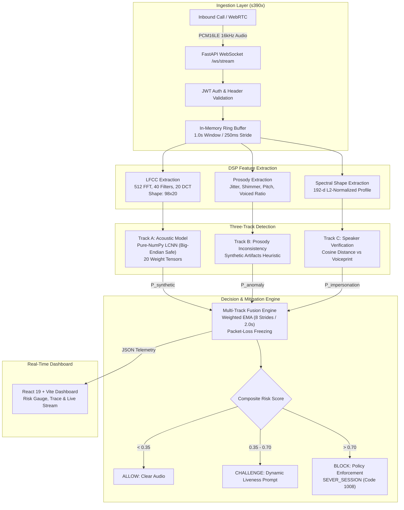

# VoiceGuard: Real-Time Voice-Clone & Scam-Call Detection Gateway on IBM LinuxONE

**Submission Title:** `[Scamengers]_IBM Z Datathon 2026 Project`  
**Track:** AI Secured: Innovation Without Exposure  
**Event Code:** SSF2026  
**Team Name:** [Scamengers]  
**Target Platform:** IBM LinuxONE (s390x, big-endian) Virtual Machine  

---

## 2. Problem: Voice-Clone Scam Calls

Generative voice cloning has transformed phone phishing and authorized push payment (APP) fraud. With fewer than three seconds of reference audio, attackers can synthesize convincing impersonations of bank executives, family members, or corporate officers.

Existing cloud-based detection solutions require forwarding raw, unencrypted telephony audio streams to external third-party proprietary APIs, creating catastrophic exposure risks for banking confidentiality, customer privacy (GDPR/GLBA/RBI compliance), and data sovereignty.

---

## 3. Training Data & Front-End Feature Contract

### Training Dataset: ASVspoof 2019 Logical Access (LA)
- **Reference Record:** University of Edinburgh DataShare ([https://datashare.ed.ac.uk/handle/10283/3336](https://datashare.ed.ac.uk/handle/10283/3336))
- **Partitions:** Standard ASVspoof 2019 LA training and development splits (`ASVspoof2019.LA.cm.train.trn.txt` and `ASVspoof2019.LA.cm.dev.trl.txt`).
- **Loss Weighting:** 9:1 class weight applied to Cross-Entropy Loss to balance the ~90% spoof prevalence in the ASVspoof 2019 LA corpus.

### Feature Extraction Contract
- **Sampling:** 16,000 Hz mono PCM16 audio.
- **Window Geometry:** 1.0 s sliding window (16,000 samples) advanced in 250 ms strides (4,000 samples).
- **Linear Frequency Cepstral Coefficients (LFCC):** Extracted via `gateway/dsp_pipeline.py`:
  - `N_FFT = 512`
  - `HOP = 160` (10 ms)
  - `WIN = 400` (25 ms Hamming window)
  - `40` linearly-spaced triangular filterbank channels across 0–8,000 Hz
  - `20` cepstral coefficients computed via Discrete Cosine Transform (DCT-II)
  - Yields an unnormalized feature matrix of shape `(98, 20)` per 1.0 s window.

---

## 4. Solution Architecture

VoiceGuard provides two complementary enterprise interfaces running entirely within the secure boundary of an IBM LinuxONE VM:

### 1. File-Level Authenticity Scoring API (`analyze_voice`)
For integration with transaction-fraud scoring engines and async review pipelines:

```python
from voiceguard.voice_scoring import analyze_voice

result = analyze_voice("call.wav", model_path="voiceguard/model/track_a_npz")
```

**Output Contract (JSON-serializable):**
```json
{
  "is_genuine": false,
  "genuine_probability": 0.0015,
  "synthetic_probability": 0.9985,
  "audio_confidence": 0.9047
}
```

#### Field Definitions
- `synthetic_probability`: Mean over active speech windows of the model's `P(synthetic)`: softmax of `[bonafide, spoof]` logits (class index 1 = spoof). Any machine-generated speech (TTS or Voice Conversion). **This is an uncalibrated raw score from a network trained with class weights; calibrate on domain calls before treating as a literal frequency.**
- `genuine_probability`: `1.0 - synthetic_probability`. The two classes sum to 1.0 (binary softmax) and are not independent.
- `is_genuine`: Boolean decision `genuine_probability >= threshold` (default 0.5). Evaluated purely on model score; does not look at `audio_confidence`.
- `audio_confidence`: 0.0 to 1.0 score measuring the reliability of the **input audio signal** for this acoustic model. It is computed entirely from signal characteristics and never from the model output. It is the weighted geometric mean of four components:
  * Speech duration (weight 0.25): 4.0 s or more of active speech -> 1.0
  * Estimated SNR (weight 0.25): 30 dB -> 1.0, falls to 0.0 at 5 dB
  * Clipping ratio (weight 0.15): 0% clipped -> 1.0, >= 1% clipped -> 0.0
  * Wideband spectral balance (weight 0.35): no spectral cliff at 4 kHz -> 1.0; 8 kHz narrowband telephony audio caps at 0.1.

### 2. Real-Time Streaming Gateway (WebSocket Wire Protocol)
- **Endpoint:** `ws(s)://<host>:8000/ws/stream?token=<JWT>` (legacy alias `/ws/stream-verify`).
- **Wire Contract (Server -> Client uses the key `"event"`, NOT `"type"`):**
  * Handshake: Client sends JSON text frame `{"type":"handshake","sample_rate":16000,"user_id":"..."}`.
  * Audio chunks: Client sends binary frames of raw PCM16 little-endian audio (`<i2`, 250 ms stride = 4,000 samples @ 16 kHz).
  * `session_started`: `{ "event": "session_started", "session_id": "...", "using_model_fallback": false }`
  * `risk_update`: `{ "event": "risk_update", "risk_score": 0.88, "risk_level": "CRITICAL", "mitigation_action": "BLOCK", "processing_latency_ms": 14.2, ... }` (`risk_level`: `SAFE` | `WARNING` | `CRITICAL` | `LOW_CONFIDENCE`; `mitigation_action`: `ANALYZING` | `ALLOW` | `CHALLENGE` | `BLOCK`)
  * `mitigation_verdict`: Emitted every 8 strides (2.0 s decision window).
  * `liveness_challenge`: Emitted if risk enters ambiguity band `[0.35, 0.70]`.
  * `enforcement_action`: `{ "event": "enforcement_action", "action": "SEVER_SESSION", "reason": "...", "risk_score": 0.88 }` followed by close code **1008** (this is an intended, policy-enforced closure, not a socket error).

---

## 5. How It Uses IBM Z / LinuxONE

This project is tailored specifically for the hardware constraints and security posture of **IBM LinuxONE (s390x, big-endian)**:

1. **On-Platform Local Inference (Zero Exposure):**
   * Sensitive telephony audio remains strictly in RAM inside the LinuxONE enclave. Audio frames live only in a sliding NumPy array and are purged and zeroed upon socket disconnect. No raw audio ever touches persistent disk or external networks.
2. **Pure-NumPy LCNN Inference Engine:**
   * `onnxruntime` has **no available wheels** for Ubuntu 24.04 on s390x.
   * We implemented `voiceguard/numpy_lcnn.py`: a pure-NumPy vectorized forward pass of the Max-Feature-Map CNN that loads 20 weight tensors (`track_a_npz/*.npy`) exported from the PyTorch checkpoint.
   * **Parity Verified:** Verified against ONNX Runtime reference on x86 (~4e-5 max logit difference vs ONNX reference in smoke test) and verified on the s390x VM with golden logits.
3. **Big-Endian Architecture Hazards Resolved:**
   * **Network PCM Decoding:** Audio over telephony/WebSockets arrives as little-endian PCM16 (`<i2`). On big-endian s390x, native `np.int16` would byte-swap the samples into broadband noise. We enforce explicit `_PCM16LE = np.dtype("<i2")` in all buffer parsing.
   * **WAV Generation:** Python's `wave.writeframes()` assumes native host byte order and swaps bytes on big-endian platforms. All test audio generation utilizes native `np.int16` without `<i2` casting.
   * **Numpy Weight Headers:** Standard `.npy` files declare `<f4`. Every weight array is cast to native `float32` upon load via `.astype(np.float32)`.
4. **Containerized JupyterLab Environment:**
   * Utilizes the official LinuxONE Community Cloud image: `registry.linuxone.cloud.marist.edu/l1cc/jupyterlab-image-s390x`.
5. **Security Hardening:**
   * Cryptographic HS256 JWT authentication on WebSocket connections.
   * `/dev/token` development gate disabled by default (returns HTTP 404 unless `ENABLE_DEV_TOKEN=1`).
   * Production mode requires explicit `AUTH_SECRET` (refuses to start with dev default unless `ALLOW_INSECURE_DEV=1`).

---

## 6. Architecture



---

## 7. Experimental Results & Verification

### Verified Golden Logits (Smoke Test)
Reproduced identically on both x86 reference and the **IBM LinuxONE s390x VM**:
- **Zeros input `(1, 98, 20)`:**
  * Expected: `[-28.1055, 19.7470]`
  * Measured on s390x: `[-28.1055, 19.7470]`
- **Ramp input `np.arange(98*20).reshape(1,98,20)/(98*20) - 0.5`:**
  * Expected: `[-19.9592, 14.1075]`
  * Measured on s390x: `[-19.9592, 14.1075]`
- **NumPy vs ONNX Discrepancy:** ~4e-5 max logit difference vs ONNX reference (smoke test prints 4.0e-5 on zeros, 2.9e-5 on ramp).

### Measured Latency & Hardware Performance
- **Pure-NumPy Inference:** ~1.3 ms per 1.0 s window.
- **Server End-to-End Stride Latency on VM:** **12–19 ms** per 250 ms audio stride (well within the real-time telephony budget).
- **Test Result on LinuxONE VM (5.0 s synthetic speech-like WAV):**
  * `synthetic_probability`: **0.9985**
  * `audio_confidence`: **0.9047**
  * Windows scored: 7 of 9 active speech windows.

---

## 8. Known Limitations

See [docs/LIMITS.md](file:///c:/Projects/Build%20VoiceGuard%20Dashboard%20(4)/docs/LIMITS.md) for full scientific limitations documentation:
- **Baseline Checkpoint (Zero Accuracy / EER Claims):** The Track A LCNN checkpoint scored 1.0 synthetic (`P(synthetic) ≈ 1.0`) on every clip tested, including clean bona fide speech. It is an end-to-end architectural baseline and hardware verification pipeline; proper calibration and retraining on ASVspoof 2019 LA are the next step. No accuracy or Equal Error Rate (EER) claims are made for this checkpoint.
- **ASVspoof 2019 LA Scope:** Clean 16 kHz English studio speech; unmeasured on regional Indian languages, dialects, or code-switching.
- **Silence Shortcut:** Well-documented dataset artifacts in ASVspoof 2019 can inflate detection scores on unpadded data.
- **Telephony Bandwidth:** Narrowband 8 kHz audio lacks high-frequency cepstral detail; flagged with lower `audio_confidence` (~0.45).
- **Binary Softmax:** TTS and Voice Conversion are grouped into `P(synthetic)`.
- **Score Calibration:** Model outputs uncalibrated raw softmax scores; operational thresholds must be tuned on domain traffic.

---

## 9. Run It

### Local Verification (x86_64 or s390x)

```bash
# 1. Run unit test suite (11 tests pass)
python3 -m pytest tests/ -v

# 2. Run golden logits smoke test
python3 scripts/smoke_test.py

# 3. Start the gateway daemon with pure-NumPy weights
export AUTH_SECRET=$(openssl rand -hex 32)
export TRACK_A_MODEL="$(pwd)/voiceguard/model/track_a_npz"
uvicorn server:app --app-dir gateway --host 127.0.0.1 --port 8000
```

### Running on the LinuxONE s390x VM

```bash
# 1. Setup environment idempotently (Ubuntu 24.04 on s390x)
bash scripts/vm_setup.sh

# 2. Run API daemon in background
./scripts/run_api.sh

# 3. Run end-to-end WebSocket streaming test
./scripts/e2e.sh
```

### Frontend Development & Build

```bash
# Build production bundle (Node 20+ / pnpm)
pnpm install
pnpm build
```

---

## 10. Technology Stack & Open-Source Citations

In strict accordance with the datathon rules, all upstream open-source libraries are credited below:

- [NumPy](https://numpy.org/) (`v1.26.4`) — Vectorized array operations and pure-NumPy LCNN forward pass.
- [SciPy](https://scipy.org/) (`v1.11.4`) — Signal processing, `resample_poly`, and FFT filterbank generation.
- [FastAPI](https://fastapi.tiangolo.com/) (`v0.143.3`) — High-performance asynchronous WebSocket and HTTP gateway.
- [Uvicorn](https://www.uvicorn.org/) (`v0.54.0`) — ASGI server implementation.
- [PyJWT](https://pyjwt.readthedocs.io/) (`v2.7.0`) — HS256 JSON Web Token verification.
- [ONNX](https://onnx.ai/) & [ONNX Runtime](https://onnxruntime.ai/) (`v1.27.0`) — Model exchange and x86 reference verification.
- [PyTorch](https://pytorch.org/) (`v2.6.0`) — LCNN training and checkpoint export.
- [scikit-learn](https://scikit-learn.org/) (`v1.9.1`) — Feature metrics and evaluation utilities.
- [soundfile](https://pysoundfile.readthedocs.io/) (`v0.14.0`) — Audio file format reader.
- [React](https://react.dev/) (`v19.0.0`) & [React DOM](https://react.dev/) — User interface component framework.
- [Vite](https://vitejs.dev/) (`v8.0.5`) — Frontend build system and development server.
- [Tailwind CSS](https://tailwindcss.com/) (`v4.0.0`) — Modern utility-first CSS design system.
- [Framer Motion](https://www.framer.com/motion/) (`v13.4.2`) — Smooth animations and telemetry transitions.
- [Lucide React](https://lucide.dev/) (`v1.47.0`) — Accessible iconography.
- [nginx](https://nginx.org/) — Reverse proxy and TLS termination on VM.
- [Docker](https://www.docker.com/) — Containerized runtime for JupyterLab on LinuxONE.

---

## 11. Team & Credits

- **Team Name:** [Scamengers]
- **Event:** IBM Z Datathon 2026 (Event Code: `SSF2026`)
- **Submission Title:** `[Scamengers]_IBM Z Datathon 2026 Project`
- **Team Members:** Team Scamengers
- **Frontend Design:** Exported via Figma Make; modified and live-stream enhanced for real-time audio risk telemetry.
